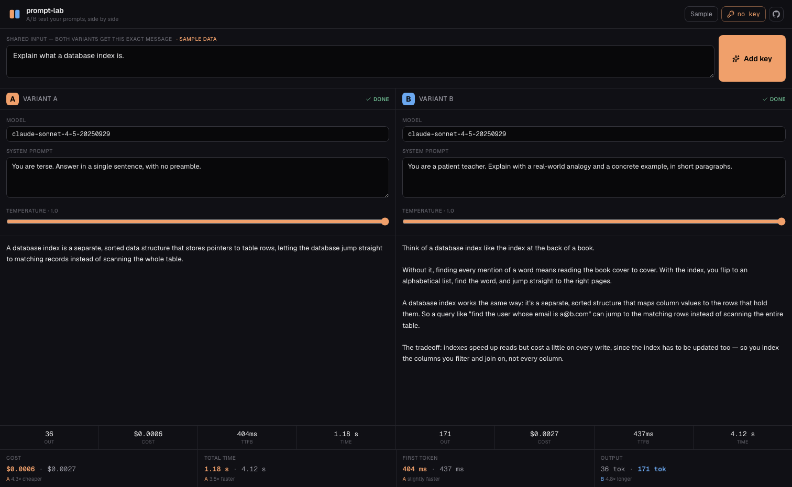

# prompt-lab

[](LICENSE)
[](https://github.com/ferhatatagun/prompt-lab/stargazers)
[](#)
[](#)
[](https://prompt-lab-promptly.vercel.app)

**A/B test your Claude prompts, side by side.**

Run one input through two prompts (or two models) at the same time, watch both
stream in parallel, then compare output, cost, and latency — so "which prompt is
better" stops being a guess.

Bring your own key. No backend. Nothing leaves your browser.

**[Live → prompt-lab-promptly.vercel.app](https://prompt-lab-promptly.vercel.app)** ·
**[See it with no key → /?demo=1](https://prompt-lab-promptly.vercel.app/?demo=1)**



---

## Why

Prompt engineering is mostly A/B testing done badly — you tweak a system prompt,
run it, squint at the output, and try to remember how the last version felt.
There's no side-by-side, and the cost/latency tradeoff is invisible.

prompt-lab makes the comparison concrete: same input, two variants, both run at
once. You see the outputs next to each other *and* the numbers — so "more
detailed" comes with "4× the tokens and 3× the latency" attached.

## What it does

- **One input, two variants** — each variant has its own model, system prompt,
  and temperature. The user message is shared.
- **Parallel streaming** — both variants stream at the same time, side by side.
- **Per-variant metrics** — output tokens, estimated cost, time-to-first-token,
  total time.
- **A verdict** — cost, speed, and output-length compared head to head, with the
  winner and the ratio (e.g. *A is 4.3× cheaper*).
- **BYOK, zero backend** — requests go straight from your browser to Anthropic;
  the key lives only in `localStorage`.
- **Sample mode** — no key? Hit *Sample* (or open `?demo=1`) to see a full
  comparison: a terse prompt vs. a teaching prompt on the same question.

## How it works

```
src/
  app/
    page.tsx          orchestration: runs both variants concurrently
    globals.css       design tokens, dark theme
  components/
    PromptCard.tsx     the shared input + run control
    VariantCard.tsx    one contestant — config, streaming output, metrics
    Scoreboard.tsx     head-to-head verdict, scored
    KeyDialog.tsx      BYOK key entry
  lib/
    anthropic.ts      fetch-based streaming client + SSE parser
    pricing.ts        tier-aware cost model
    sample.ts         the built-in sample comparison
    types.ts          variant + result types
```

Both variants are fired concurrently from one click — each gets its own
`AbortController`, its own stream, and its own slice of state — so the page
is genuinely racing two requests, not running them one after another.

Cost is estimated from the model *tier* (opus / sonnet / haiku, detected from
the model name), so dated snapshots and future versions still price sensibly.

## Run locally

```bash
npm install
npm run dev
# open http://localhost:3000
```

You'll need an Anthropic API key — create one at
[console.anthropic.com](https://console.anthropic.com/settings/keys).

## Deploy

Static, no environment variables. One-click on Vercel:

[](https://vercel.com/new/clone?repository-url=https://github.com/ferhatatagun/prompt-lab)

## Read the story

The case for measuring prompt iteration instead of shipping by vibes:

- [**Your prompt isn't better. You just remember it being better.**](https://ferhatatagun.com/blog/stop-choosing-prompts-by-vibes)
  — why "feels better" is not data, what side-by-side comparison surfaces
  that sequential never does (output, latency, cost in one view), and a
  worked example where the shorter prompt won by 28% cost / 41% latency
  with no semantic loss on what mattered.

## Tech

Next.js 16 · React 19 · TypeScript · Tailwind CSS v4 · Framer Motion

## A small suite

Five tools for seeing what Claude is doing, built together with a shared design language:

- [claudoscope](https://github.com/ferhatatagun/claudoscope) — x-ray your Claude API calls
- [agent-replay](https://github.com/ferhatatagun/agent-replay) — replay an agent's tool-calling loop
- **prompt-lab** — A/B test prompts side by side *(this one)*
- [tool-lab](https://github.com/ferhatatagun/tool-lab) — interactive tool-use sandbox
- [context-lens](https://github.com/ferhatatagun/context-lens) — see a Claude prompt before you ship it

## License

MIT — see [LICENSE](LICENSE).
